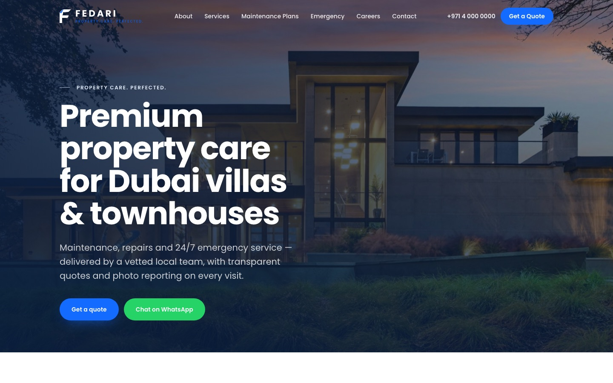

# Fedari — Property Care Website

Marketing website for **Fedari**, a premium home-maintenance company serving villas and townhouses in Dubai.

**Live demo:** https://shasuani.github.io/fedari-web/



## Highlights

- **11 pages + 9 generated service pages.** Services are defined once in `src/data/services.ts`, and `src/pages/services/[slug].astro` renders a page for each.
- **Lead capture.** A reusable, accessible `LeadForm` component with client-side validation and async submission. It powers the maintenance-plan enquiry and emergency-request forms. A WhatsApp call-to-action and a sticky mobile action bar sit alongside it.
- **SEO.** A shared `SEO` component handles titles, descriptions, canonical URLs and Open Graph tags. The site also has `schema.org` LocalBusiness JSON-LD, an auto-generated sitemap and `robots.txt`.
- **Single source of truth.** Company details, services, plans, FAQs, testimonials and vacancies live in typed data modules under `src/data/`. One edit updates the whole site.
- **Continuous deployment.** Every push to `main` is built and published to GitHub Pages by GitHub Actions.

## Tech stack

[Astro 4](https://astro.build) · TypeScript · Tailwind CSS · `@astrojs/sitemap` · GitHub Actions · GitHub Pages

## Getting started

```bash
npm install
npm run dev       # http://localhost:4321
npm run build     # static output in dist/
npm run preview   # serve the production build locally
```

## Project structure

```
src/
├── components/   # Header, Footer, LeadForm, SEO, ServiceCard, MobileActionBar, …
├── data/         # site config, services, plans, FAQs, testimonials, JSON-LD
├── layouts/      # BaseLayout
└── pages/        # routes, including services/[slug].astro
public/           # images, icons, robots.txt
.github/workflows # build & deploy to GitHub Pages
```

> Contact details (phone, WhatsApp, form endpoint) are placeholders in `src/data/site.ts` until the client launch.
